<p align="center">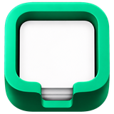</p>
<h1 align="center">Zings</h1>
<p align="center"><strong>Your tasks. Your server.</strong><br>An open-source, self-hosted Things 3 alternative. Runs in the browser and installs as an app on desktop and phone.</p>
<p align="center">
  <a href="https://github.com/greeenos/zings/releases"></a>
  <a href="LICENSE"></a>
  <a href="https://github.com/greeenos/zings/actions/workflows/docker.yml"></a>
  <a href="https://ghcr.io/greeenos/zings"></a>
</p>
<p align="center"><a href="#watch-zings-in-action">Watch the film</a> · <a href="https://zings.vercel.app/demo/">Try the demo</a> · <a href="#install">Install</a> · <a href="docs/user-guide.md">User guide</a> · <a href="#support-zings">Support Zings</a></p>

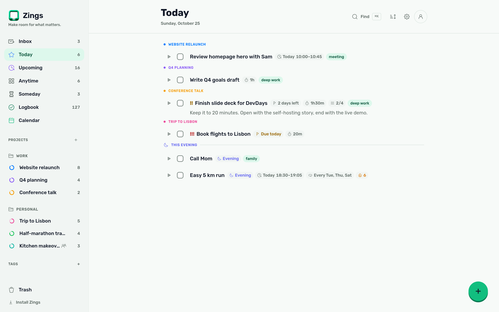

Capture ideas in your Inbox, make a plan for Today and leave the rest for later. Zings brings a familiar task-planning rhythm to your own server, with shared projects, attachments and a browser app you can install on your devices.

It runs as one Docker container with PocketBase and SQLite: a **45 MB image** that idles at about **30 MB of RAM**, with a ~170 KB (gzipped) web app. No Node.js process at runtime. No telemetry in the app, and your workspace stays on the backend you choose.

## Watch Zings in action

https://github.com/user-attachments/assets/fd2bb39b-80c0-4697-8ff8-82b133325920

Task planning, shared projects and the mobile app in 30 seconds. [Watch on the website](https://zings.vercel.app/#film) · [Download the film](https://github.com/greeenos/zings/raw/refs/heads/main/media/zings-showreel.mp4) · [English subtitles](media/zings-showreel.srt)

## Try the demo

Try Zings in your browser without creating an account. Your demo changes stay in your browser.

[Open the demo](https://zings.vercel.app/demo/)

## What you can do

| Plan your work | Keep the useful details |
| --- | --- |
| Inbox, Today, Upcoming, Anytime, Someday and Logbook | Notes, checklists, tags and file attachments |
| Areas, projects, headings and shared projects | Separate scheduling dates and deadlines |
| Recurring tasks, including every third Tuesday | Priorities and projects that reveal one next step at a time |
| English and Czech natural-language task entry | Task timers, focus history and activity charts |
| Calendar view and external ICS subscriptions | Private ICS export of planned work and tracked sessions |
| Keyboard navigation, multi-select and drag ordering | Optional client-side encryption for task notes |
| Things 3 import and full JSON export | Light, dark and auto themes |

Install Zings as a **PWA** on your phone or desktop. Previously loaded lists work offline, and task changes queue until the backend is reachable again. Reminders use browser notifications and Web Push on supported devices; HTTPS and permission are required.

For integrations, use the **REST API**, webhooks and email-to-task endpoint. AI breakdown and capture work with your own Anthropic or OpenRouter key. [Setup and examples](docs/user-guide.md).

**Calendar status:** Zings can subscribe to external ICS feeds and publish its own. It doesn't yet write edits back into Google, Apple or Outlook calendars.

## A closer look

<table><tr><td width="50%"><strong>Inside a task</strong><br>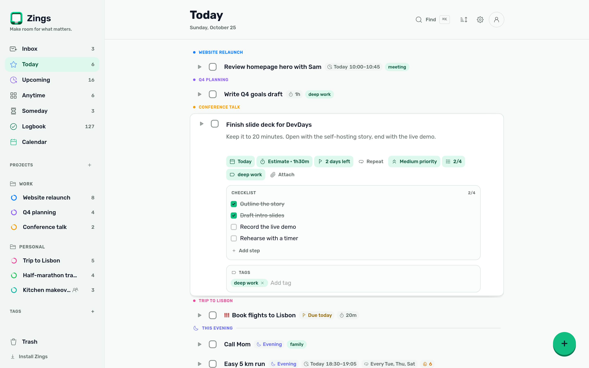</td><td width="50%"><strong>The week ahead</strong><br>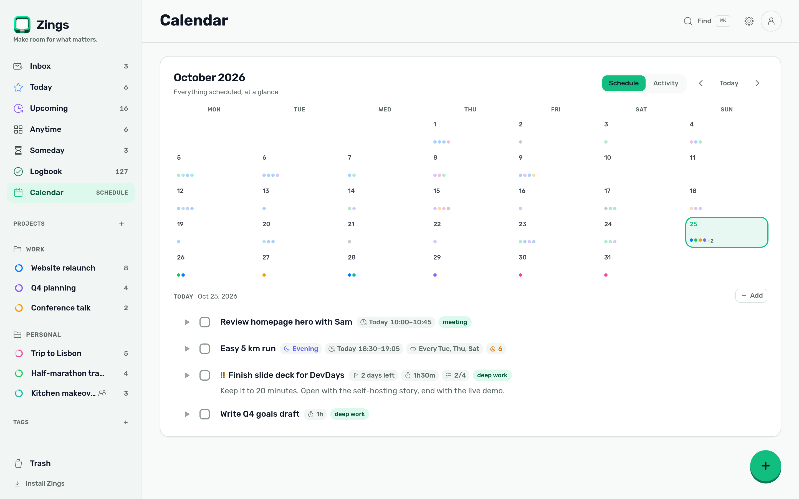</td></tr><tr><td><strong>After dark</strong><br>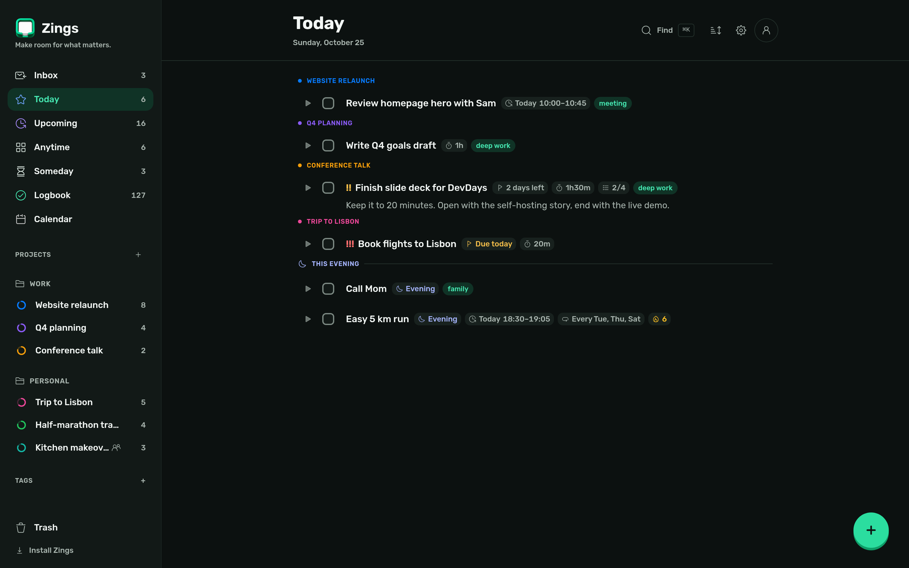</td><td><strong>Focus over time</strong><br>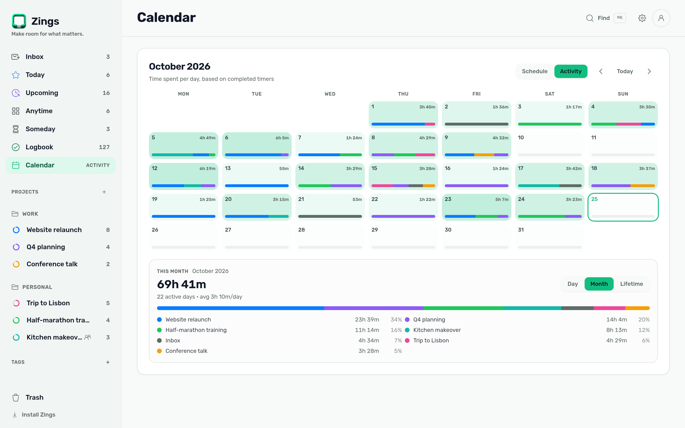</td></tr></table>

<details><summary>Phone views, upcoming tasks and the design system</summary>

<p>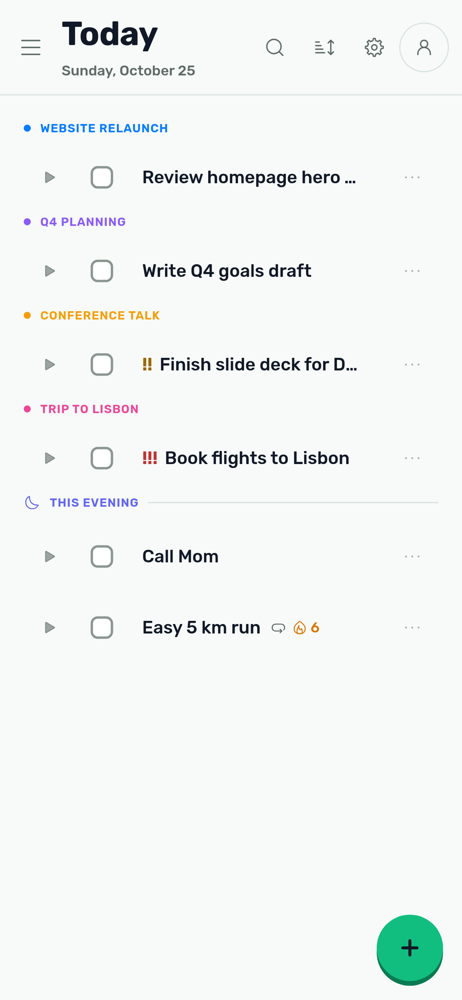 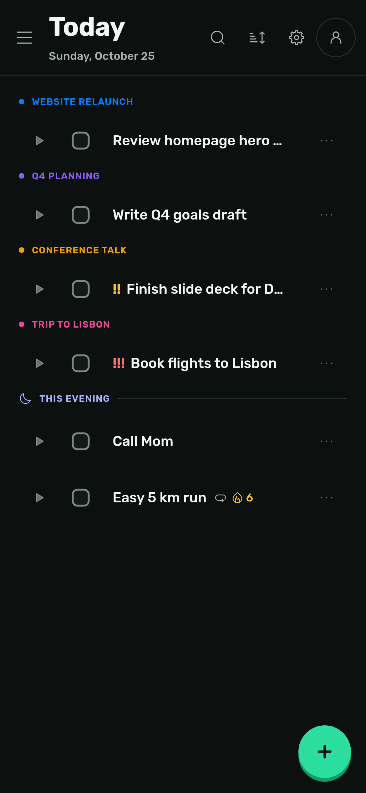</p>

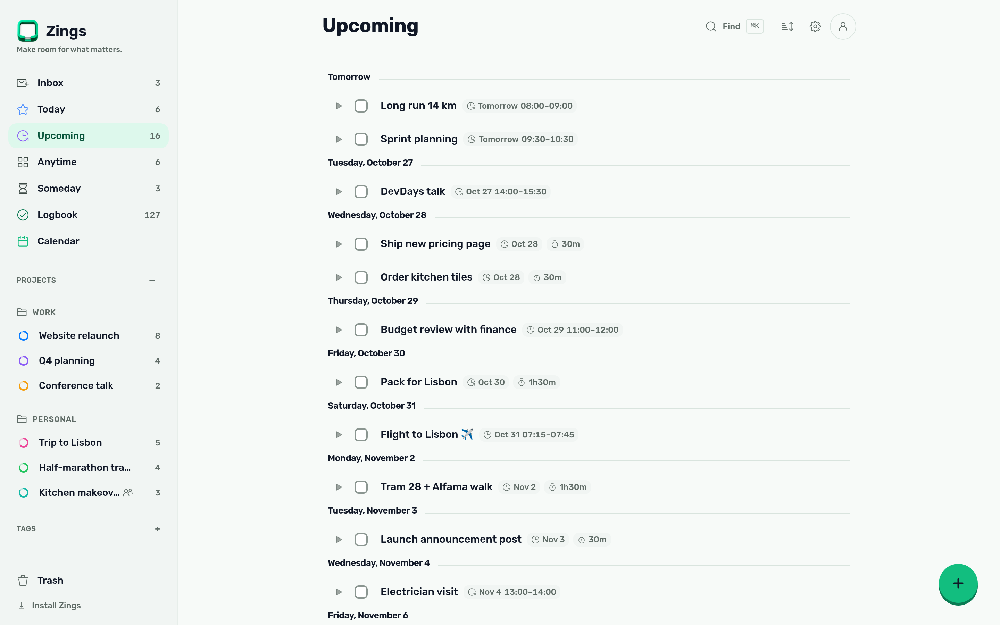
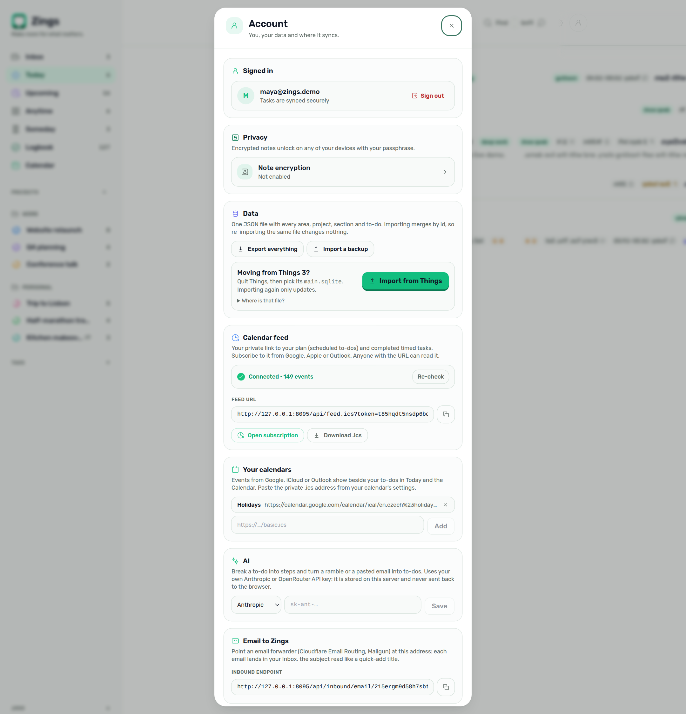

</details>

## Install

[Install Docker](https://docs.docker.com/get-docker/), then run:

```bash
docker run -d --name zings --restart unless-stopped \
  -p 8090:8090 -v zings:/pb/pb_data -e TZ=Europe/Prague \
  ghcr.io/greeenos/zings:latest
```

Open **http://localhost:8090** and create an account. The `zings` volume holds the database and files. A self-hosted instance supports up to **five accounts**, each with its own workspace; projects can be shared between them.

Prefer Compose?

```bash
curl -fsSL https://raw.githubusercontent.com/greeenos/zings/main/docker-compose.yml -o docker-compose.yml
docker compose up -d
```

Use HTTPS for PWA installation, encryption and push reminders. For private access, follow the [Tailscale guide](docs/user-guide.md#access-it-from-your-phone-anywhere-in-the-world-tailscale).

### Updates and backups

Pull the new image, recreate the container with the same volume, and keep an independent backup of that volume. PocketBase also creates daily backups at 03:00 in the configured timezone and keeps the latest seven.

```bash
docker pull ghcr.io/greeenos/zings:latest
docker stop zings
docker rm zings
# Run the installation command again, keeping -v zings:/pb/pb_data.
```

[Admin setup, SMTP, imports, offline behaviour and backup recovery](docs/user-guide.md).

## Build it yourself

Requires Node.js 20+ and the [PocketBase binary](https://pocketbase.io/docs/).

```bash
npm ci
npm run build
pocketbase serve
# App and backend: http://localhost:8090
```

For UI development, keep PocketBase running and use `npm run dev`. Run `npm test`, `npm run lint` and `npx tsc --noEmit -p tsconfig.app.json` before submitting code.

The app uses **Preact, TypeScript, Vite, Tailwind and PocketBase**. [CONTRIBUTING.md](CONTRIBUTING.md) covers contributions; [SECURITY.md](SECURITY.md) covers vulnerability reports.

## Support Zings

Donations help cover development and server costs. You can also support the project by reporting bugs, contributing code or sharing it with someone who needs it.

**[Donate via Revolut or card](https://revolut.me/93af)**

| Ethereum | Solana |
| --- | --- |
| **Ethereum mainnet** | **Solana mainnet** |
|  | 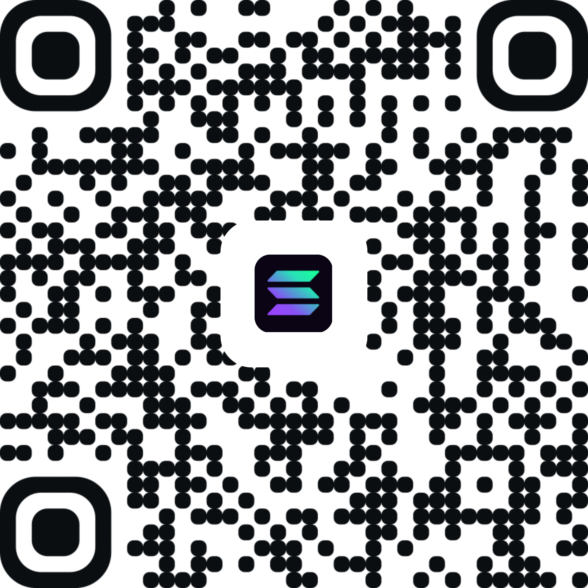 |
| `0x72160619F847068AB307447d363D580d85A47002` | `DjnRV3h6VkvGCHiYSaqU2VKR66NCva46UYdQSfZtP4sd` |

Use the matching network and check the address in your wallet before sending. These are voluntary donations, not payments for an app subscription.

## Feedback and sharing

[Report a bug](https://github.com/greeenos/zings/issues/new) or suggest a feature. Focused pull requests are welcome.

[Changelog](CHANGELOG.md)

Zings is an independent project inspired by Things 3. It isn't affiliated with Cultured Code or Apple.

## License and credits

The code is [MIT licensed](LICENSE). UI icons use [Iconoir](https://iconoir.com/) (MIT). Empty-state artwork uses the [Solar icon set](https://www.figma.com/community/file/1166831539721848736) by 480 Design, under [CC BY 4.0](https://creativecommons.org/licenses/by/4.0/).

Showreel music: **“Inspired” by Kevin MacLeod (incompetech.com)**, [track source](https://remote.incompetech.com/music/royalty-free/index.html?Search=Search&isrc=USUAN1600022), licensed under [Creative Commons Attribution 4.0](https://creativecommons.org/licenses/by/4.0/).
